<picture>
  <source media="(prefers-reduced-motion: reduce) and (max-width: 560px)" srcset="./assets/crimson-orbit-mobile.svg#still">
  <source media="(prefers-reduced-motion: reduce)" srcset="./assets/crimson-orbit.svg#still">
  <source media="(max-width: 560px)" srcset="./assets/crimson-orbit-mobile.svg">
  
</picture>

  I’m a Computer Science &amp; AI student interested in software engineering, machine learning, and cybersecurity. I learn by testing ideas, making tools I’d use myself, and contributing to open source.

  <picture>
    
  </picture>

  <a href="https://khushaldangar.vercel.app/">Portfolio</a> &ensp;·&ensp;
  <a href="https://www.linkedin.com/in/khushaldangar">LinkedIn</a> &ensp;·&ensp;
  <a href="https://x.com/DangarKhushal" title="X / Twitter">X</a> &ensp;·&ensp;
  <a href="mailto:khushaldangar29@gmail.com">Email</a>

