<picture>
  <source media="(prefers-reduced-motion: reduce) and (max-width: 900px)" srcset="./assets/crimson-cosmos-mobile.svg#still">
  <source media="(prefers-reduced-motion: reduce)" srcset="./assets/crimson-cosmos.svg#still">
  <source media="(max-width: 900px)" srcset="./assets/crimson-cosmos-mobile.svg">
  
</picture>

  I’m a Computer Science &amp; AI student exploring software engineering, machine learning, cybersecurity, and open source. I enjoy building things, experimenting with ideas, and figuring out how systems work.

  

  <a href="https://khushaldangar.vercel.app/">Portfolio</a> &ensp;·&ensp;
  <a href="https://www.linkedin.com/in/khushaldangar">LinkedIn</a> &ensp;·&ensp;
  <a href="https://x.com/DangarKhushal" title="X / Twitter">X</a> &ensp;·&ensp;
  <a href="mailto:khushaldangar29@gmail.com">Email</a>

